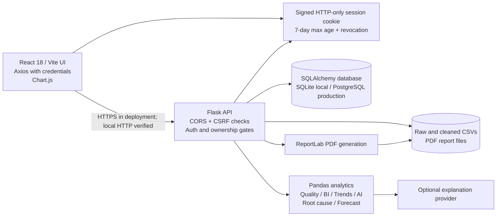

# Project Audit Inventory

**Audit date:** 2026-11-04

## Repository and backup status

The workspace contains `CSV-Dashboard-Project-main/`, but neither it nor its
parent has a `.git` directory. Consequently, `git status`, recent commit
inspection, a clean/dirty determination, and a backup commit were unavailable.
No existing files or uploaded datasets were reset or removed.

Runtime and environment files were not printed or copied into this inventory.
The backend `.env` is ignored by `backend/.gitignore`; its local file mode is
`0600`. The frontend `.env` contains only comments explaining the hostname-based
API fallback. Because Git metadata is absent, whether any files are tracked
cannot be confirmed.

## Architecture

In the local browser test, the frontend ran at `127.0.0.1:5173` and the backend
at `127.0.0.1:5001`. The frontend derives the local API host from the page host
when `VITE_API_URL` is unset, avoiding the host-only cookie mismatch between
`localhost` and `127.0.0.1`.

## Project inventory

| Area | Contents and responsibility |
|---|---|
| `frontend/src/App.jsx`, `App.css`, `main.jsx` | Authenticated dashboard shell, sidebar, charts, upload and core analytics views |
| `frontend/src/AdvancedAnalytics.jsx` | AI Analyst, root-cause, forecast, reports, and dataset-management views |
| `frontend/src/__tests__/App.test.jsx` | React/Vitest tests for auth, navigation, analytics, session restoration, and PDF-download callback |
| `frontend/package.json`, `package-lock.json`, `vite.config.js` | Pinned frontend dependencies, npm scripts, and Vite/Vitest setup |
| `backend/app.py` | Flask initialization, auth, upload, download, analytics, and report routes |
| `backend/auth.py`, `rate_limiter.py` | Signed sessions, CSRF, password hashing, revocation, and login throttling |
| `backend/config.py`, `.env.example`, `alembic.ini`, `migrations/` | Environment configuration and database migrations |
| `backend/database.py`, `models.py`, `dataset_service.py`, `storage.py` | SQLAlchemy persistence, ownership, lifecycle, and filesystem storage |
| `backend/analytics/` | Data quality, BI, AI analysis, descriptive root-cause decomposition, and forecast baseline |
| `backend/report_service.py` | User-owned PDF creation and report storage |
| `backend/tests/` | Pytest suites for APIs, auth, uploads, analytics, lifecycle, migrations, and reports |
| `backend/tests/fixtures/audit_workflow.csv` | Reproducible audit fixture with dates, dimensions, numeric measures, a duplicate, and one missing value |
| `render.yaml` | Example Render production service configuration; not evidence of deployment |
| `docs/` | Existing phase, rollback, auth, module, deployment, and audit documentation |

`backend/uploads/` contains existing ignored runtime data. Its contents were
left untouched and were not inspected as part of this source inventory.

## Dependencies and commands

- Frontend: React 18, Vite, Axios, Chart.js, `react-chartjs-2`, `html2canvas`,
  Lucide React, Vitest, and React Testing Library. There is a lockfile.
- Backend: Flask, Flask-CORS, Pandas, openpyxl, Gunicorn, SQLAlchemy, Alembic,
  psycopg, python-dotenv, and ReportLab. Production/test requirements are
  separated, but backend versions are mostly not locked.
- Available frontend scripts: `npm test`, `npm run build`, `npm run dev`, and
  `npm run preview`. No frontend lint script is configured.
- Backend test command: `python3 -m pytest -q`. No separate static-analysis or
  lint configuration was found in the inspected project manifests.

## Feature inventory

Implemented modules include Overview & Charts, Data Quality & Profile, Business
Intelligence, Trends & Comparisons, AI Analyst, Root Cause Analysis, Predictive
Analytics, Business Reports, Upload Dataset, Dataset Management, and Settings.
The AI module calculates supported results deterministically and optionally
uses an LLM only for constrained explanations. Root-cause output is descriptive,
not causal. Forecasting is an evaluated last-observation baseline rather than a
trained advanced model.

The audit found and fixed malformed auth payloads causing 500 responses,
duplicate normalized column names breaking trend calculations, and the
generated-report download button passing a click event instead of its report
identifier. See `PROJECT_AUDIT_REPORT.md` for reproduction and verification.

## Inventory limitations

The source was reviewed along with the project manifests, tests, configuration,
documentation, and local live workflows. There was no Git history to compare,
no live production environment, and no configured production database or LLM
provider available for this audit.
